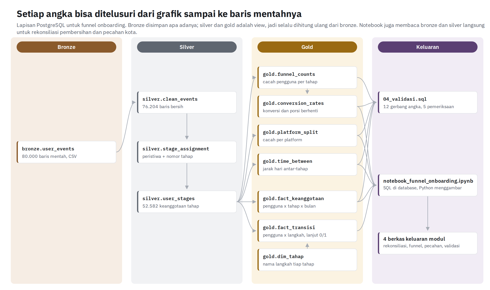

# App Onboarding Funnel Drop-off Analysis

Dari 14.874 orang yang mendaftar, hanya 8.144 menyelesaikan verifikasi telepon: 6.730 orang (45,25%) berhenti di satu langkah itu, di ketiga platform sekaligus. Selisih antarplatform di langkah tersebut hanya 1,82 poin, terlalu kecil untuk menjadi dasar prioritas. Studi kasus analisis funnel onboarding sebuah super-app (modul SQL-03): ELT di PostgreSQL dengan lapisan bronze, silver, dan gold, lalu analisis di Python.

**Halaman portofolio:** `index.html` (aktifkan GitHub Pages dari branch `main`, folder root).



## Alur pengerjaan

| Lapisan | Isi | Dibangun oleh |
|---|---|---|
| Bronze | `user_events` mentah apa adanya: 80.000 baris, 20.000 pengguna | `sql/01_bronze.sql` + Load di notebook |
| Silver | Data bersih (76.204 baris) dan keanggotaan tahap per pengguna (52.582 baris) | `sql/02_silver.sql` |
| Gold | Funnel, konversi, pecahan platform, jarak waktu, dan data per pengguna untuk dipotong | `sql/03_gold.sql` |
| Analisis | Uji statistik, uji ketahanan, grafik temuan, empat berkas keluaran modul | `notebook_funnel_onboarding.ipynb` |

Setiap skrip SQL diakhiri tabel gerbang (ukuran, nilai, harapan, status), dan `sql/04_validasi.sql` mencocokkan angka di ketiga lapisan sekaligus. Hasil gerbangnya tersimpan di `bukti/`.

## Isi repositori

| Lokasi | Isi |
|---|---|
| `index.html` | Portofolio web |
| `notebook_funnel_onboarding.ipynb` | **Sumber utama.** Load ke PostgreSQL, Transform ke silver dan gold, validasi, analisis, grafik, ekspor berkas, temuan. Keluarannya tersimpan, jadi tabel dan grafik bisa dibaca langsung di GitHub |
| `sql/01_bronze.sql` … `04_validasi.sql` | Empat skrip lapisan, masing-masing diakhiri tabel gerbang |
| `sql/funnel_analysis_Aulia_Aorama.sql` | Jawaban challenge SQL-03 (tujuh CTE wajib), dalam dialek PostgreSQL |
| `berkas/01..04_*.csv` | Empat berkas keluaran: rekonsiliasi pembersihan, tabel funnel, pecahan platform dan kota, hasil validasi |
| `bukti/` | Tabel gerbang silver, gold, dan validasi lintas lapisan |
| `grafik/` | Bagan alur pengerjaan dan grafik temuan |
| `docs/portofolio_funnel_2026-10-08.pdf` | Portofolio versi dokumen |
| `docs/memo-keputusan_funnel_2026-10-08.pdf` | Memo satu halaman untuk pemegang anggaran |
| `docs/catatan-keputusan_funnel_2026-10-08.pdf` | Definisi, keputusan K1 sampai K9, temuan, rekomendasi, batas, kueri |
| `docs/lampiran-bukti_funnel_2026-10-08.pdf` | Sembilan gambar berketerangan empat bagian |

**Data mentah tidak disertakan.** `user_events.csv` (80.000 baris peristiwa) adalah data latihan dari modul dan tidak dipublikasikan ulang. Folder `data/` sudah tercantum di `.gitignore`.

## Arti warna grafik

Merah hanya untuk kehilangan (pengguna berhenti atau hilang), merah tua untuk yang terbesar. Hijau hanya untuk pengguna yang lanjut. Ungu untuk cacah dan perbandingan yang tidak punya arah baik-buruk, seperti platform dan jarak waktu. Kuning tua untuk penanda perhatian, seperti cacat pencatatan dan rata-rata yang menyesatkan.

## Menjalankan ulang

1. Pasang PostgreSQL 16+ dan buat database kosong bernama `funnel_onboarding`.
2. Letakkan `user_events.csv` dari modul di folder `data/`.
3. Pasang pustaka Python, lalu jalankan semua sel notebook (password PostgreSQL diminta di sel pertama dan tidak disimpan):

```bash
pip install jupyterlab pandas matplotlib scipy sqlalchemy psycopg2-binary
jupyter lab notebook_funnel_onboarding.ipynb
```

Notebook memuat CSV ke bronze bila tabelnya masih kosong (dan melewatinya bila sudah berisi 80.000 baris), membangun silver dan gold, lalu menganalisis. Gerbang angka: 80.000 → 76.850 → 76.350 → 76.204 baris; 52.582 keanggotaan tahap; cacah lima tahap 19.946 / 14.874 / 8.144 / 5.652 / 3.966. Notebook berhenti dengan galat kalau satu dari empat belas gerbang meleset.
