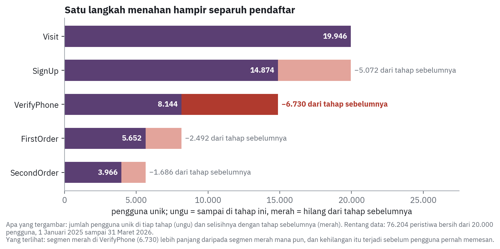
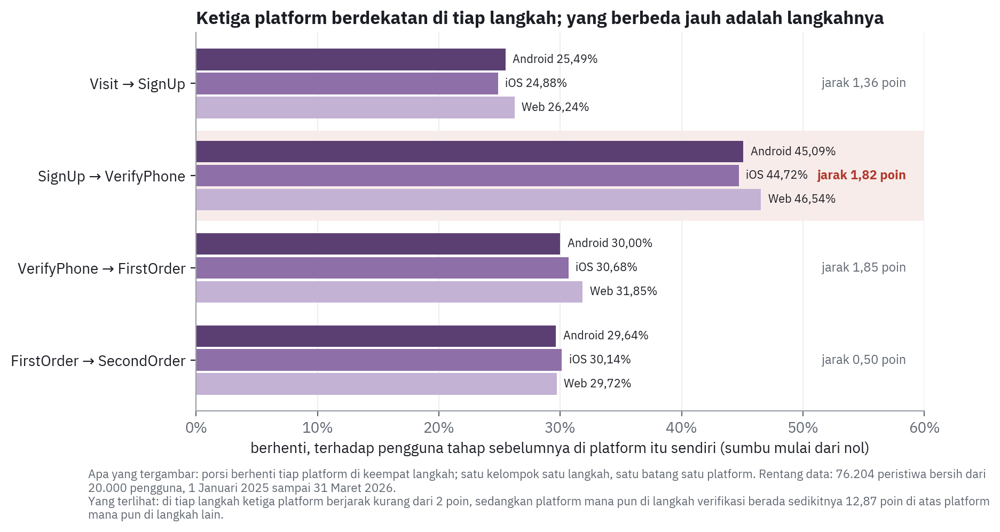
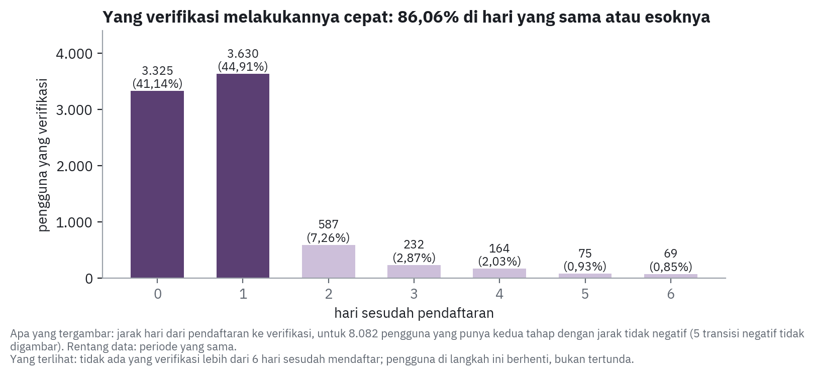
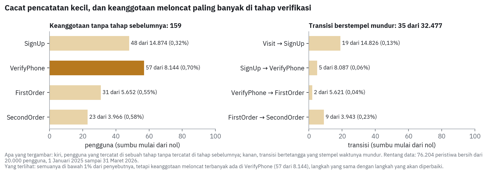
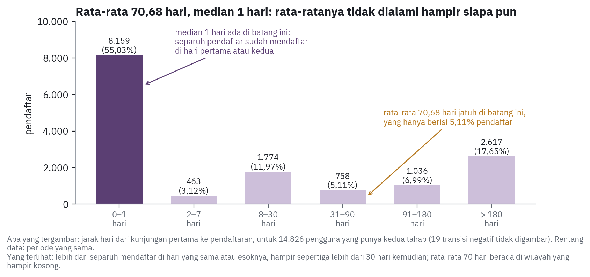
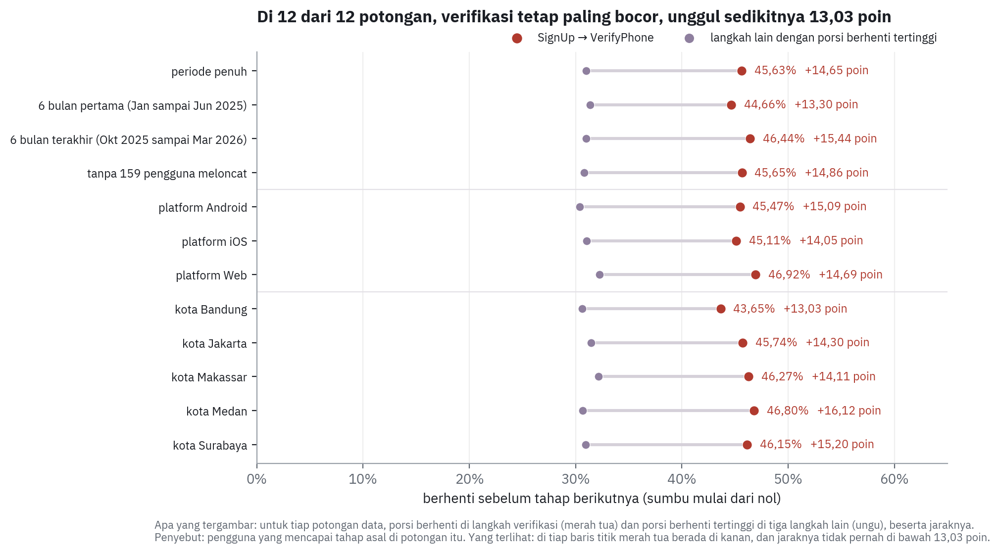

# Funnel Onboarding Super-App: Dari Titik Kebocoran ke Satu Antrean Kerja yang Tepat

Studi kasus **modul SQL-03 Funnel Analysis**. Sebuah super-app membelanjakan **Rp 2 miliar per bulan** untuk akuisisi, tetapi hanya sekitar seperlima pengunjungnya sampai ke pesanan kedua. Analisis ini membangun funnel lima tahap dari 80.000 peristiwa mentah dengan ELT di PostgreSQL (lapisan bronze, silver, gold), lalu menganalisisnya di Python. Hasilnya: **6.730 dari 14.874 pendaftar (45,25%) berhenti di verifikasi telepon**, di ketiga platform sekaligus, dan langkah itu paling bocor di 15 dari 15 bulan serta 12 dari 12 potongan data. Penjelasan yang paling sering diajukan, bahwa satu platform lebih buruk, ditolak: selisihnya hanya 1,82 poin dan tidak bisa dibedakan dari kebetulan.


## Tautan cepat

| Hasil | Tautan |
|---|---|
| Halaman portofolio | <https://aoramaaulia-collab.github.io/App-Onboarding-Funnel-Dropoff-Analysis/> |
| Notebook analisis | [notebook_funnel_onboarding.ipynb](notebook_funnel_onboarding.ipynb) |
| Memo keputusan (1 halaman) | [docs/memo-keputusan_funnel_2026-10-08.pdf](docs/memo-keputusan_funnel_2026-10-08.pdf) |
| Catatan keputusan | [docs/catatan-keputusan_funnel_2026-10-08.pdf](docs/catatan-keputusan_funnel_2026-10-08.pdf) |
| Lampiran bukti (9 gambar) | [docs/lampiran-bukti_funnel_2026-10-08.pdf](docs/lampiran-bukti_funnel_2026-10-08.pdf) |
| Portofolio versi PDF | [docs/portofolio_funnel_2026-10-08.pdf](docs/portofolio_funnel_2026-10-08.pdf) |

## Daftar isi

1. [Ringkasan hasil](#ringkasan-hasil)
2. [Latar belakang dan masalah bisnis](#latar-belakang-dan-masalah-bisnis)
3. [Tujuan dan ukuran](#tujuan-dan-ukuran)
4. [Dataset](#dataset)
5. [Arsitektur dan alur proyek](#arsitektur-dan-alur-proyek)
6. [ELT dan pembersihan](#elt-dan-pembersihan)
7. [Keputusan analisis](#keputusan-analisis)
8. [Temuan](#temuan)
9. [Validasi dan uji ketahanan](#validasi-dan-uji-ketahanan)
10. [Keterbatasan](#keterbatasan)
11. [Rekomendasi](#rekomendasi)
12. [Struktur folder](#struktur-folder)
13. [Cara menjalankan](#cara-menjalankan)
14. [Tech stack](#tech-stack)
15. [Penulis](#penulis)

---

## Ringkasan hasil

| Item | Hasil (76.204 peristiwa bersih, 20.000 pengguna, Jan 2025 sampai Mar 2026) |
|---|---|
| Cacah lima tahap | Visit 19.946 → SignUp 14.874 → VerifyPhone 8.144 → FirstOrder 5.652 → SecondOrder 3.966 |
| Langkah paling bocor | SignUp ke VerifyPhone: **45,25% berhenti** (6.730 orang), lawan 25,43%, 30,60%, dan 29,83% di tiga langkah lain |
| Ketahanan | Porsi berhenti verifikasi tertinggi di **15 dari 15 bulan** dan **12 dari 12 potongan data**; jarak terkecil 13,03 poin |
| Platform | Web 53,46%, Android 54,91%, iOS 55,28% di langkah verifikasi: jarak **1,82 poin**, p = 0,27 |
| Kota | 53,51% sampai 56,69%, p = 0,17 |
| Kecepatan verifikasi | 86,06% yang verifikasi melakukannya dalam dua hari pertama; tidak satu pun lebih dari 6 hari |
| Jarak kunjungan ke pendaftaran | rata-rata 70,68 hari, tetapi **median 1 hari** |
| Mutu pencatatan | 159 keanggotaan tahap meloncat; 35 dari 32.477 transisi berstempel mundur (0,11%) |
| Konversi keseluruhan | 19,88% (3.966 dari 19.946 pengunjung) |

---

## Latar belakang dan masalah bisnis

Pak Fajar, VP of Product, memegang anggaran akuisisi Rp 2 miliar per bulan dan satu tim produk berisi delapan orang dengan **satu antrean kerja** perbaikan per kuartal. Yang ia butuhkan bukan angka konversi, melainkan jawaban: **di tahap mana pengguna onboarding hilang**, supaya antrean itu diarahkan ke tempat yang benar.

| Cara membaca funnel | Akibatnya |
|---|---|
| Membandingkan konversi keseluruhan antarplatform | Web berada di dasar daftar (18,88% lawan 20,15% Android), sehingga tampak menjadi prioritas, padahal jaraknya hanya 1,27 poin |
| Membandingkan porsi berhenti di tiap langkah | Satu langkah yang dilalui ketiga platform menahan hampir separuh pendaftar |

Antrean yang diarahkan ke tempat yang salah menghabiskan satu kuartal tanpa menggerakkan apa pun, sementara anggaran akuisisi terus mengisi funnel yang bocor di tempat yang sama.

---

## Tujuan dan ukuran

**Tujuan:** menemukan langkah onboarding yang paling banyak kehilangan pengguna, menguji apakah temuan itu bertahan di berbagai potongan data, dan menetapkan ukuran yang bisa membatalkan rekomendasinya.

| Ukuran | Peran | Alasan |
|---|---|---|
| **Konversi terhadap tahap tepat sebelumnya** | Ukuran utama | Hanya penyebut ini yang menilai tiap langkah atas dasar orang yang benar-benar sampai di sana |
| Porsi terhadap Visit | Pembanding | Menjawab berapa yang sampai sejauh ini, tetapi tahap terakhir selalu tampak paling buruk; tidak dipakai untuk memilih langkah |
| Cacah orang hilang | Pendamping | Persentase tanpa satuan orang menyembunyikan besarnya masalah |
| Median jarak waktu | Pendamping | Rata-rata jarak waktu ditarik oleh segelintir pengguna yang sangat lambat |
| Uji chi-square dan dua proporsi | Penguji | Memisahkan selisih yang nyata dari kebetulan sebelum dijadikan dasar keputusan |

Satuan hitungnya **pengguna unik**, bukan baris peristiwa. Menghitung baris menggelembungkan tiap tahap 4,05% sampai 4,62% tanpa satu orang pun bertambah.

---

## Dataset

Satu tabel peristiwa, `user_events`, dari modul: **80.000 baris, 20.000 pengguna, 1 Januari 2025 sampai 31 Maret 2026**.

| Kolom | Isi |
|---|---|
| `EventID` | Identitas peristiwa |
| `UserID` | Identitas pengguna |
| `EventName` | Nama peristiwa: lima tahap funnel (Visit, SignUp, VerifyPhone, FirstOrder, SecondOrder) dan peristiwa lain |
| `EventTimestamp` | Waktu peristiwa |
| `Platform` | Android, iOS, atau Web |
| `City` | Bandung, Jakarta, Makassar, Medan, atau Surabaya |

Data tidak memuat percobaan, catatan pengiriman kode verifikasi, maupun alasan pengguna berhenti. **Data mentah tidak disertakan di repositori**, karena milik penyelenggara modul.

---

## Arsitektur dan alur proyek


| Tahap | File | Isi |
|---|---|---|
| 1. Load | `sql/01_bronze.sql` + notebook | Skema `bronze`, `silver`, `gold`; CSV dimuat apa adanya ke `bronze.user_events` |
| 2. Silver | `sql/02_silver.sql` | Pembersihan, pemetaan tahap, dan satu baris per pengguna per tahap; diakhiri gerbang 8 baris |
| 3. Gold | `sql/03_gold.sql` | Funnel, konversi, pecahan platform, jarak waktu, dan data per pengguna; diakhiri gerbang 12 baris |
| 4. Validasi | `sql/04_validasi.sql` | 12 gerbang angka lintas lapisan dan lima pemeriksaan modul |
| 5. Analisis | `notebook_funnel_onboarding.ipynb` | Uji statistik, uji ketahanan, grafik, empat berkas keluaran, temuan |
| Jawaban challenge | `sql/funnel_analysis_Aulia_Aorama.sql` | Template SQL-03 dengan tujuh CTE wajib, dalam dialek PostgreSQL |

---

## ELT dan pembersihan

```
user_events.csv (80.000 baris)
   -> bronze.user_events          disimpan apa adanya
   -> silver.clean_events         76.204 baris bersih
   -> silver.stage_assignment     peristiwa + nomor tahap 1 sampai 5
   -> silver.user_stages          52.582 keanggotaan tahap (satu baris per pengguna per tahap)
   -> gold.*                      funnel, konversi, pecahan, jarak waktu, data per pengguna
   -> Python                      uji, grafik, berkas keluaran
```

| Langkah | Alasan |
|---|---|
| Bronze disimpan apa adanya | Data mentah tidak pernah diubah, jadi aturan pembersihan bisa diperbaiki tanpa kehilangan sumbernya |
| Silver dan gold sebagai view | Selalu dihitung ulang dari bronze; tidak ada salinan yang basi |
| Gerbang di akhir tiap skrip | Setiap lapisan membuktikan angkanya sendiri (ukuran, nilai, harapan, status) sebelum lapisan berikutnya dipakai |
| SQL di database, Python untuk analisis | Logika data terbaca dan bisa diaudit sebagai SQL; Python hanya mengambil hasil, menguji, dan menggambar |

**Rekonsiliasi pembersihan:**

| Tahap | Baris dibuang | Porsi dari mentah | Sisa |
|---|---|---|---|
| Baris mentah | | | 80.000 |
| Baris kembar persis (kelima kolom isi sama) | 3.150 | 3,94% | 76.850 |
| Nama peristiwa kosong | 500 | 0,63% | 76.350 |
| Stempel waktu sesudah akhir periode | 146 | 0,18% | 76.204 |
| **Total** | **3.796** | **4,75%** | **76.204** |

Pengguna unik tetap 20.000 sesudah pembersihan. Membuang 146 baris masa depan sudah diuji dan tidak mengubah cacah tahap mana pun.

---

## Keputusan analisis

Sembilan keputusan ditulis di catatan keputusan, masing-masing dengan alternatif yang ditolak. Lima yang paling menentukan angka:

| Keputusan | Alternatif yang ditolak, dan kenapa |
|---|---|
| Baris kembar dikenali dari kelima kolom isi; `EventID` dikeluarkan dari kunci | Kiriman ulang klien mendapat `EventID` baru, jadi baris kembar tidak akan pernah tertangkap |
| Satuan: pengguna unik per tahap, pada peristiwa pertamanya | Menghitung baris peristiwa menggelembungkan tiap tahap 4,05% sampai 4,62% |
| Konversi terhadap tahap tepat sebelumnya, penyebut ditulis di setiap angka | Penyebut Visit untuk semua langkah membuat tahap terakhir selalu tampak paling bermasalah |
| Model bersarang diperiksa; 159 keanggotaan meloncat dilaporkan, tidak dibuang | Membuangnya demi funnel yang rapi berarti menghapus satu-satunya bukti tentang mutu pencatatan |
| Jendela waktu dipotong per pengguna, menurut waktu masuk ke tahap asal | Menyaring peristiwa ke enam bulan terakhir membuat SignUp (7.507) melebihi Visit (5.917) |

---

## Temuan

Temuan utama menentukan ke mana satu antrean kerja diarahkan. Temuan pendukung menentukan cara menjalankan rekomendasinya dan batas klaim yang boleh dibuat.

### Utama 1: satu langkah menahan 6.730 dari 14.874 pendaftar



Konversi SignUp ke VerifyPhone 54,75%, artinya **45,25% pendaftar berhenti di situ**. Porsi berhenti di tiga langkah lain 25,43%, 30,60%, dan 29,83%. Dalam satuan orang, langkah ini **kehilangan lebih banyak daripada dua langkah terakhir digabung** (6.730 lawan 4.178).

**Aksi bisnis:** satu antrean kerja kuartal ini diarahkan ke langkah verifikasi telepon, untuk ketiga platform sekaligus.

### Utama 2: selisih antarplatform terlalu kecil untuk jadi dasar prioritas



| Platform | Konversi verifikasi | Konversi keseluruhan |
|---|---|---|
| iOS | 55,28% | 20,11% |
| Android | 54,91% | 20,15% |
| Web | 53,46% | 18,88% |

Arahnya konsisten (Web terendah di tiga dari empat langkah), tetapi **jarak terlebarnya 1,82 poin dan tidak bisa dibedakan dari kebetulan** (p = 0,27). Platform mana pun di langkah verifikasi berada sedikitnya 12,87 poin di atas platform mana pun di langkah lain: **yang membedakan adalah langkahnya, bukan platformnya**. Yang tidak diklaim: bahwa platform tidak berpengaruh.

**Aksi bisnis:** jangan memprioritaskan satu platform, termasuk Web.

### Pendukung 1: di langkah verifikasi, orang berhenti, bukan tertunda



**86,06%** pendaftar yang verifikasi melakukannya di hari daftar atau esoknya, dan tidak satu pun lebih dari 6 hari kemudian.

**Aksi bisnis:** uji perbaikan di langkah ini cukup dibaca 7 hari sesudah tiap pendaftaran, tidak perlu menunggu satu kuartal.

### Pendukung 2: alat ukurnya belum sepenuhnya bisa dipercaya



159 keanggotaan tahap muncul tanpa tahap sebelumnya, dan 35 dari 32.477 transisi bertetangga berstempel mundur. Tanpa ke-159 pengguna itu, langkah verifikasi tetap terburuk (45,65% berhenti), jadi temuan utama tidak berubah. Keanggotaan meloncat terbanyak ada di VerifyPhone (57 dari 8.144).

**Aksi bisnis:** audit pencatatan peristiwa verifikasi sebelum hasil uji dibaca.

### Pendukung 3: rata-rata jarak kunjungan ke pendaftaran menyesatkan



Rata-rata 70,68 hari, tetapi median 1 hari: 55,03% mendaftar di hari yang sama atau esoknya, dan 29,75% lebih dari 30 hari kemudian. Angka rata-rata itu tidak dialami hampir siapa pun, jadi selalu dilaporkan bersama median.

---

## Validasi dan uji ketahanan

| Pemeriksaan | Hasil | Catatan |
|---|---|---|
| 1. Funnel menurun monoton | lolos | Pengguna tiap tahap tidak pernah melebihi tahap sebelumnya |
| 2. Konversi di rentang 0 sampai 100% | lolos | Tahap pertama bernilai kosong, bukan nol |
| 3. Durasi negatif | tercatat | 35 dari 32.477 transisi (0,11%); dilaporkan, tidak dibuang |
| 4. Jumlah platform sama dengan total | lolos | Cocok sampai satuan di kelima tahap; kota juga cocok |
| 5. Tiap tahap himpunan bagian tahap sebelumnya | tidak lolos | 159 keanggotaan meloncat: SignUp 48, VerifyPhone 57, FirstOrder 31, SecondOrder 23 |

Pemeriksaan kelima sengaja dibiarkan tidak lolos. Ia menguji asumsi model funnel, bukan kebenaran kueri, sehingga kegagalannya dilaporkan sebagai batas alat ukur.



Porsi berhenti di langkah verifikasi tertinggi di setiap potongan: periode penuh, dua jendela enam bulan, tanpa pengguna yang meloncat, tiap platform, dan tiap kota. Jarak terkecilnya 13,03 poin (Bandung).

---

## Keterbatasan

1. **Tidak ada percobaan di data.** Tidak ada klaim kenaikan, penghematan, atau ROI; rekomendasinya berbentuk uji dengan kelompok pembanding.
2. **Tidak ada catatan pengiriman kode verifikasi maupun alasan berhenti.** Analisis ini menunjukkan *di mana* orang berhenti, bukan *kenapa*.
3. **159 keanggotaan tahap meloncat.** Temuan dihitung ulang tanpa mereka dan tidak berubah, tetapi dua tabel kota yang sama-sama benar berjumlah 8.087 dan 8.144.
4. **35 transisi berstempel mundur (0,11%).** Semua angka jarak waktu punya batas ketelitian.
5. **Satu platform dan satu kota per pengguna.** Perpindahan perangkat tidak bisa diuji.
6. **6.730 adalah selisih bersih dua cacah tahap.** Pendaftar yang benar-benar tidak pernah verifikasi berjumlah 6.787 (45,63%), karena 57 orang terverifikasi tidak pernah tercatat mendaftar. Kesimpulannya sama.
7. **Banyak perbandingan.** Penurunan verifikasi di awal 2026 (p = 0,04) muncul di antara belasan perbandingan, jadi diperlakukan sebagai pertanyaan, bukan temuan.

---

## Rekomendasi

| Prioritas | Rekomendasi | Dasar |
|---|---|---|
| **Mendesak** | Satu antrean kerja kuartal ini untuk langkah verifikasi telepon, ketiga platform sekaligus, sebagai uji dengan kelompok pembanding acak | 6.730 dari 14.874 berhenti (45,25%); tertinggi di 15 dari 15 bulan |
| **Dahulukan** | Audit kelengkapan pencatatan peristiwa verifikasi sebelum hasil uji dibaca | 159 keanggotaan meloncat; 35 transisi mundur |
| **Jangan** | Memprioritaskan satu platform, termasuk Web | Jarak 1,82 poin (p = 0,27) di langkah terburuk |
| **Jangan** | Menjanjikan kenaikan lima poin persentase | Tidak ada percobaan di data; angka itu target rapat, bukan temuan |
| **Periksa** | Tanyakan perubahan alur verifikasi atau penyedia SMS di akhir 2025 | Jan sampai Mar 2026 53,07% lawan 2025 54,91%; p = 0,04, bukti lemah |

**Ukuran yang bisa membatalkan rekomendasi,** ditetapkan sebelum perbaikan dikerjakan:

| Ukuran | Nilai awal |
|---|---|
| Konversi pendaftaran ke verifikasi, kelompok uji lawan pembanding, dibaca 7 hari sesudah tiap pendaftaran | 54,75% |
| Jumlah pendaftar yang menyelesaikan verifikasi, dalam satuan orang | 8.144 dari 14.874 |
| Cacah keanggotaan meloncat | 159 |

---

## Struktur folder

```
App-Onboarding-Funnel-Dropoff-Analysis/
├── index.html                        halaman portofolio (GitHub Pages)
├── notebook_funnel_onboarding.ipynb  Load, Transform, validasi, analisis, grafik, berkas, temuan
├── sql/
│   ├── 01_bronze.sql                 skema dan tabel data mentah
│   ├── 02_silver.sql                 pembersihan dan keanggotaan tahap, + gerbang silver
│   ├── 03_gold.sql                   funnel, konversi, pecahan, jarak waktu, + gerbang gold
│   ├── 04_validasi.sql               gerbang lintas lapisan dan lima pemeriksaan
│   └── funnel_analysis_Aulia_Aorama.sql   jawaban challenge SQL-03 (tujuh CTE)
├── berkas/                           empat berkas keluaran modul (CSV)
├── bukti/                            tabel gerbang silver, gold, dan validasi
├── grafik/                           bagan alur dan grafik temuan
├── docs/                             portofolio PDF, memo, catatan keputusan, lampiran bukti
└── data/                             tidak di-push (data mentah modul)
```

---

## Cara menjalankan

1. Pasang **PostgreSQL 16+** dan buat database kosong bernama `funnel_onboarding`.
2. Letakkan `user_events.csv` dari modul di folder `data/`.
3. Pasang pustaka Python, lalu jalankan semua sel notebook. Password PostgreSQL diminta di sel pertama dan tidak disimpan.

```bash
git clone https://github.com/aoramaaulia-collab/App-Onboarding-Funnel-Dropoff-Analysis.git
cd App-Onboarding-Funnel-Dropoff-Analysis
pip install jupyterlab pandas matplotlib scipy sqlalchemy psycopg2-binary
jupyter lab notebook_funnel_onboarding.ipynb
```

Notebook memuat CSV ke bronze bila tabelnya masih kosong (dan melewatinya bila sudah berisi 80.000 baris), membangun silver dan gold, memvalidasi, lalu menganalisis. Ia berhenti dengan galat kalau satu dari empat belas gerbang angka meleset: 80.000 → 76.850 → 76.350 → 76.204 baris; 52.582 keanggotaan tahap; cacah lima tahap 19.946 / 14.874 / 8.144 / 5.652 / 3.966.

Lapisan yang sama juga bisa dibangun tanpa notebook: jalankan `sql/01_bronze.sql`, impor CSV ke `bronze.user_events`, lalu jalankan `02`, `03`, dan `04` berurutan di pgAdmin atau `psql`.

---

## Tech stack

| Kategori | Tools |
|---|---|
| Bahasa | SQL, Python 3.11+ |
| Database dan ELT | PostgreSQL 16 (schema bronze, silver, gold; view), psycopg2, SQLAlchemy |
| Analisis dan statistik | pandas, NumPy, SciPy (chi-square, uji dua proporsi) |
| Visualisasi | matplotlib |
| Lingkungan | JupyterLab, pgAdmin 4 |

**Arti warna grafik:** merah hanya untuk kehilangan (merah tua untuk yang terbesar); hijau hanya untuk pengguna yang lanjut; ungu untuk cacah dan perbandingan tanpa arah baik-buruk; kuning tua untuk penanda perhatian.

---

## Penulis

**Aulia Aorama**, studi kasus modul SQL-03 Funnel Analysis

- GitHub: [aoramaaulia-collab](https://github.com/aoramaaulia-collab)
- Email: aoramaaulia@gmail.com
